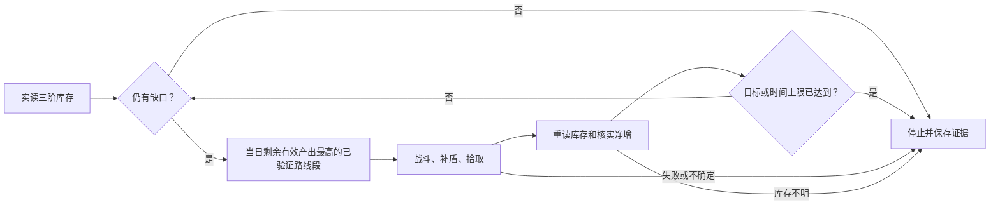

# 刀镡路线接入研究

当前状态：独立 `material-route` 档已实现并完成首段实机执行。5处战斗点清理、实际库存净增、补盾与画质恢复通过独立核验。素材执行与常规培养档分开，路线仍需本机白名单、版本固定和逐段验收。

```powershell
python -B scripts/workflow.py run --profile material-route --route-config config/material-route.json --execution-mode foreground --no-delay --timeout-minutes 16
```

单段原生最多8分钟，含启动及前后库存双读整轮最多16分钟，当日额外原生刷取累计最多30分钟。前台录屏可用 `scripts/run_daily_recorded.ps1 -Profile material-route -TimeoutMinutes 16`，私有配置同上述默认路径。配置文件和下载的第三方路线不进入公开包。

首次实机发现原生时长在日志保留浮点JSON、经JS转存后为整数JSON；验证器已只对有限时长数值做严格等值比较，其余身份、资源、队伍和事件类型不放宽。历史unknown结果保留，原证据离线重核通过，没有重打路线。登录窗口由用户手工处理；程序会在无法进入主界面时停止并恢复画质。

后续实机仍发现野外状态限制：明亮HUD的歧义角色判断已在严格护盾路径修正为先按目标号位、连续两帧确认；但腾空、角色切换冷却、网络延迟和战斗锁定可能导致安全停止。部分路线失败不抹去已独立核实的前后库存净增，也不把末点未见敌人宣称为清理完成。当前还需要完整四人匹配时跳过无必要编队、安全区域传送恢复，以及所有材料切人统一落地／冷却等待；这些后续恢复方案尚未实机验收，不能称全天路线已稳定。

## 选择当日有效产出最高的路线

正式选路优先能够减少所需刀镡缺口的当日产出总量；同收益候选再比较材料等值／分钟、稳定性与耗时。将单岛和多岛高覆盖路线组一并比较，保留各阶直接需求并折算合法3:1链；无关材料和超出培养需求的产出不增加目标进度评分。

以尚未清理、实际会掉刀镡的敌人点位计算有效覆盖，排除重叠或当日已清理点。有实际记录时采用前后库存净增；无实测时只采用明确标注的敌人／材料数量并注明不确定。fight动作数或路径点数不能代表敌人数、掉落量或“最多”。

按UTC+8 04:00划分调度游戏日，同一已清理刷怪点当天默认一次。文件名、作者或哈希变更不能解除已清理点位记录；仅按路线文件去重不够。高覆盖路线按互不重叠的段执行，记录已完成点位并继续剩余段，禁止从头重跑未知结果。具体敌人／敌人组的实际刷新及掉落规则仍需核实，调度日重置不自动证明敌人已刷新。

2026-10-09静态核对的高覆盖候选：[野伏众@提瓦特钓鱼玳师](https://github.com/babalae/bettergi-scripts-list/tree/main/repo/pathing/%E6%95%8C%E4%BA%BA%E4%B8%8E%E9%AD%94%E7%89%A9/%E9%87%8E%E4%BC%8F%E4%BC%97/%E9%87%8E%E4%BC%8F%E4%BC%97%40%E6%8F%90%E7%93%A6%E7%89%B9%E9%92%93%E9%B1%BC%E7%8E%B3%E5%B8%88)有48个JSON路线文件，文件名目标数量标注合计220，覆盖多个稻妻岛屿。此数不是去重敌人数、fight点数或实测掉落量；同组16个、13个标注的段可优先验证。XS组9文件也保留比较，不能仅按文件数量排名。安装前须重新固定commit／各文件哈希并核对目录完整性，本次未保存tree commit SHA和truncated标志。

## 推荐接法

把刀镡刷取加入独立的 `material-route` 节点：读取三阶刀镡 → 计算缺口及合法3:1合成的等值缺口 → 选择当日剩余有效产出最高的已订阅路线段 → 拾取 → 重读实际库存 → 决定停止。保留各阶直接需求，不将假设合成写成实际库存，也不把低阶等值缺口解释为只能刷低阶掉落。



优先复用BGI地图追踪，避免启动整个锄大地一条龙的全部路线。现有接口 `pathingScript.run`、`runFile`、`runFileFromUser` 已提供路线调用；后者在 `User/AutoPathing` 路径边界内读取订阅文件。参考[官方脚本调用文档](https://www.bettergi.com/dev/js/otherscript.html)、[地图追踪](https://www.bettergi.com/feats/autos/pathing.html)与[仓库订阅](https://www.bettergi.com/feats/autos/srepo.html)。

社区作者XS的[刃连岛-刀镡](https://github.com/babalae/bettergi-scripts-list/blob/main/repo/pathing/%E6%95%8C%E4%BA%BA%E4%B8%8E%E9%AD%94%E7%89%A9/%E9%87%8E%E4%BC%8F%E4%BC%97/%E9%87%8E%E4%BC%8F%E4%BC%97%40XS/%E5%88%83%E8%BF%9E%E5%B2%9B-%E5%88%80%E9%95%A1.json)保留为单段接口验收候选，正式路线将比较高覆盖路线组的有效收益。未确认路线的明确再分发许可，本项目仅提供链接，运行时使用用户本机订阅且哈希固定的副本。

## 执行器与核验边界

- **明确结果和单次取消。** 新 `RunMaterialRoute` 入口绑定runId和路线哈希，返回明确完成／失败／取消结果及链接取消令牌。普通 `AutoPathingScript.Run` 保持原行为；其正常返回不能证明成功。禁止以不可取消的 `Promise.race` 代替超时停止。
- **共享护盾守卫。** 严格路线战斗通过 `AutoFightHandler` 共享已验收的钟离长E守卫，核验实际队伍、技能冷却并在安全命令边界补盾；普通默认战斗行为保持。
- **普通怪拾取与库存证据。** 避免只拾精英设置漏掉野伏众材料。前后读数必须可信，掉落日志不能直接累加成库存；零增量和中断分别记录。
- **有界运行及点位去重。** 默认关闭，首次接口验收仅一段，建议段8分钟、含扫描和收尾12分钟上限；这是待实测上限，不是正式路线选择标准。高覆盖路线分段继续，已清理点位不因重启、换作者或换文件自动重放。
- **独立零树脂节点。** 不修改初验树脂累计账本，不冒充秘境领奖成功，不启用升级、合成、周本或其他地图任务。按当日有效材料总收益选择路线组，同收益候选再比较效率。委托与清树脂核心日常仍以约20分钟为目标，额外材料路线单独计时并设有界额度。

路线可用时间取单次上限与整轮剩余时间的较小值；不足以完成已实测路线时不启动，明确列为待办。缩短超时、少完成任务或零树脂演练不等于更快完成正常日常。

每轮证据应包含runId/gameDate、路线作者／相对路径／SHA256、实际队伍和战斗／拾取策略、开始及结束状态、前后库存与净增、耗时、异常与画质恢复。结果不明时停止，不自动重放。

## 一次登录连续执行两段

新增 `material-route-session` 档，复用单次启动、登录、录屏和画质租约。私有 `config/material-route-session.json` 包含 `partyName`、按号位排列的完整 `expectedTeam`、固定策略 `木偶星超导`、`requireZhongliShield: true`、`safeHub: "mondstadt-city"` 及恰好两个 `segments`；每段使用单段同样的固定路线字段，独立 `timeoutSeconds` 为60至480秒。两个段共同预留当日额度，并核对彼此与当天已尝试区域的重叠。配置、路线、账户证据及录像不随公开源码发布。

```powershell
powershell -NoProfile -ExecutionPolicy Bypass -File scripts/run_daily_recorded.ps1 -Profile material-route-session -RouteSessionConfig config/material-route-session.json -TimeoutMinutes 16
```

启动和每段结束均返回固定蒙德城安全地点，核验加载、主界面、落地、无复苏提示、实际小地图坐标及四人号位。实际队伍匹配时跳过编队；启动时必要换队仅在安全地点进行。所有材料战斗切人入口统一有界检查腾空／冷却和目标身份，保留同角色持键宏与实际长E补盾标准。

每段有独立运行ID、双次前后库存、原生结束事件和结果文件；父会话不混用成功或收益。路线、库存或返回安全地点任一项未核实，立即停止后续段。已核实的部分收益保留，已清理或未知点位不重跑。整会话包含扫描和恢复的上限为16分钟，路线原生执行仍受当天30分钟累计额度限制；离线检查通过不能代替两段连续实机验收。

## 只验证安全恢复

`material-recovery` 是独立零资源诊断档，只执行固定安全地点传送与完整队伍核验，不读库存、不运行路线或攻击，也不读取或预留刷怪账本。私有配置 `config/material-recovery.json` 只含 `partyName`、`expectedTeam`、`safeHub: "mondstadt-city"` 和不超过60秒的 `timeoutSeconds`。整轮包含启动和收尾最多4分钟。

```powershell
powershell -NoProfile -ExecutionPolicy Bypass -File scripts/run_daily_recorded.ps1 -Profile material-recovery -RecoveryConfig config/material-recovery.json -TimeoutMinutes 4
```

材料模式传送必须观察按钮并发送确认，再核验连续两帧加载与两帧世界HUD；关闭地图不能被当作已传送。路线移动前还必须有两帧实际到点坐标，容差保持20单位，不能用返回的目标坐标替代观测。匹配失败时保留实际拒绝读数，仅有界等待新帧，禁止盲目移动或重传。恢复节点成功也不等于刷怪路线完成。未尝试审计失效时恢复完整预留计费；旧记录中的0秒不能继续豁免额度，旧事实记录保持。

材料区域选择先连续两帧确认菜单标题，再读取实际选项并匹配完整区域名；新版宽菜单使用材料专用标题搜索范围，共享识别资产和普通Core分支保持。该菜单修复已编译及通过保留录像离线核验，尚未实机验收；固定蒙德严格恢复已实机通过，不能据此声明跨区域战斗或两段连续运行成功。

## English

The `material-route-session` profile runs exactly two independently scoped routes using one login, recorder and graphics lease. Its private configuration pins both routes and the complete slot-ordered party. Startup and per-segment recovery must prove the fixed Mondstadt hub, loading transition, grounded world UI, absence of revive prompts, actual minimap coordinates and party identity. A failed route, uncertain inventory or failed recovery stops continuation; verified partial gains are retained without replaying cleared or uncertain points. Route reservations remain subject to the daily native budget, and the whole session including scans and recovery is capped at sixteen minutes. Offline checks do not establish successful consecutive live execution.

The independent `material-recovery` profile performs only a fixed-hub recovery, with no inventory scan, attack, route selection or farming lease. It is capped at sixty native seconds and four minutes including startup and cleanup. Material teleportation requires an observed confirmation button, issued confirmation, two loading frames, two world-UI frames and two actual arrival positions before route movement. A closed map is not proof of teleportation. Rejected coordinates are retained without weakening the original twenty-unit arrival bound.

The independent `material-route` profile is implemented and passed a first-segment live check: five battle points, shield refreshes, actual inventory gain and verified graphics restoration. Select subscribed, allowlisted and hash-pinned route groups by the highest expected useful daily handguard yield. Use yield per minute, reliability and duration as tie-breakers. Read all three inventory tiers twice before and after execution; preserve direct tier requirements and distinguish hypothetical crafting from actual stock.

A static directory review on 2026-10-09 found 48 JSON files in the linked multi-island author group, with filename target-count annotations totaling 220. These are unverified author annotations, not unique enemies or material drops. Compare overlap and measured yield before ranking it against the nine-file XS group; pin the actual version again before installation.

The new custom engine entry `pathingScript.RunMaterialRoute(requestJson, token)` adds explicit results, scoped native events, pinned-file validation and linked cancellation. The existing generic pathing APIs retain their prior behavior. The verified Zhongli guard is shared with strict route combat, with actual party recognition and no food, revive or resin use.

Start interface validation with one segment and measured time bounds, then execute high-coverage route groups in non-overlapping segments. Deduplicate cleared enemy locations across route files using a UTC+8 04:00 scheduling day; changing authors or hashes does not authorize a replay. Exact enemy respawn rules still require verification. Enable handguard loot pickup and stop on uncertain results. Route data is not bundled without confirmed redistribution permission. Core commissions and resin tasks retain their roughly 20-minute target, while extra material farming is measured separately: eight minutes native per segment, sixteen minutes per runner and thirty minutes native per scheduling day. Account authentication requires manual user input. Only an independently validated no-attempt audit may release a reservation; uncertain combat is never replayed automatically.
